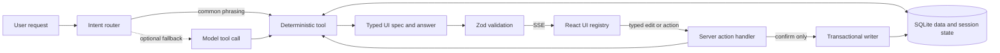

# Nance

Nance is a prototype money assistant that turns plain-language requests into short answers and interactive, data-backed UI. It uses a synthetic transaction history; it does not connect to banks or provide investment picks.

## Demo Video 
[Video Link](https://youtu.be/Hynafp-uJ_w)
## Try it

Requirements: Docker and Docker Compose.

```bash
cp .env.example .env
docker compose up --build
```

Open [http://localhost:3000](http://localhost:3000). The six common demo flows work without an API key. To enable model routing for less common phrasing, add either `GROQ_API_KEY` or `GEMINI_API_KEY` to `.env`, then restart the container.

Try asking:

- “Where did my money go last month?”
- “I want to spend less on food.”
- “Make a Goa trip group with Rahul and Priya and add yesterday’s hotel and cab.”
- “Can I afford an ₹80k phone by March?”
- “Add the Swiggy ones to the group.”
- “Which stock should I buy?”

Stop the app with `Ctrl+C`. Docker Compose may leave the container running; use `docker compose down` to stop and remove it.

## How it works

The model can help route an unfamiliar request, but it does not write UI or financial figures. Deterministic server tools read the local SQLite data, build answers and typed UI specs, and validate them before the React client renders them. Changes are proposed as drafts and only saved after explicit confirmation. Conversation and in-progress UI state are stored so they survive refreshes.



## Add a UI component

The UI contract lives in `server/src/ui/spec.ts`; client renderers live in `web/src/registry.tsx`. To add a component:

1. Define its Zod spec and add it to the `UiSpec` discriminated union.
2. Have a server tool return that spec using values from validated inputs and database queries.
3. Add a typed renderer and a matching `case` in `RenderUi`. The exhaustive switch makes an unhandled spec type a TypeScript error.
4. If the UI needs interactions, add a typed `ActionPayload` variant and handle it on the server; keep writes behind the existing confirmation flow.
5. Run `npm run typecheck` and `npm test` in `server/`, then `npm run build` in `web/`.

## Develop

Install dependencies in `server/` and `web/` separately with `npm install`. Seed the synthetic database, then run each development server in its own terminal:

```bash
cd server
npm run seed
npm run dev
```

```bash
cd web
npm run dev
```

Open [http://localhost:5173](http://localhost:5173). Vite proxies API requests to the server on port 3000. To set model routing or a different date for local development, export `GROQ_API_KEY` or `GEMINI_API_KEY` and optionally `CURRENT_DATE` in the server's shell before starting it.

Useful server commands (run from `server/`):

| Command              | Purpose                                                         |
| -------------------- | --------------------------------------------------------------- |
| `npm test`           | Run the test suite                                              |
| `npm run typecheck`  | Check TypeScript types                                          |
| `npm run eval`       | Evaluate prompts against expected intents, UI, and data         |
| `npm run bench`      | Profile in-process query latency                                |
| `npm run bench:http` | Measure HTTP/SSE response latency (requires the server running) |

The evaluator skips its LLM-only prompts if no provider key is configured. Set `EVAL_SKIP_LLM=1` to explicitly run only the deterministic subset.

## Evaluation and benchmarks

Recorded results from one full run (48 prompts, 2026-11-23, Groq `openai/gpt-oss-20b`):

| Evaluation                            |                                     Result |
| ------------------------------------- | -----------------------------------------: |
| Intent / UI type                      |                               48 / 48 each |
| Expected fields / numeric checkpoints |                       368 / 368; 579 / 579 |
| Model calls                           |                     4 (44 routed by rules) |
| Tokens / reported cost                | 3,116 input + 226 output; $0.0003015 total |
| Handler latency                       |                12.57 ms p50; 519.93 ms p95 |

Local HTTP/SSE benchmark, 30 samples per scenario across the six rule-routed prompts:

| Measure              |    p50 |    p95 |
| -------------------- | -----: | -----: |
| First SSE bytes      | 2.8 ms | 5.3 ms |
| Complete UI response | 4.0 ms | 6.0 ms |

These are single-run local measurements, not availability or browser-paint guarantees. Rerun with `npm run eval` or `npm run bench:http` from `server/` (the latter requires the app running). The evaluator uses a temporary database clone; LLM-only prompts need a configured provider key.

## Continuous integration

GitHub Actions runs on pushes and pull requests. The workflow installs server and web dependencies, seeds the synthetic database, type-checks and tests the server, and builds the web app. No API keys are needed.

## Data and scope

`data/dataset.json` contains deterministic synthetic transactions for one fictional user. The seed database is generated locally; it contains no real financial data. Relative dates default to `2026-11-23` so examples and evaluation are reproducible; override with `CURRENT_DATE` when needed.

This prototype is English-only and has no authentication, bank connections, or multi-user permissions. Group visibility is global in the prototype, so it is intended for local evaluation rather than shared or production use.

Savings projections assume no existing goal savings and estimate surplus from recent average income minus spend; they are not an affordability guarantee. Group matching is limited to a bounded period and keyword window, and expense splits are equal-only. Unsupported or missing dates and amounts prompt for clarification. If optional model routing fails, the assistant falls back to a notice.
